# UniFi Sonar

**Een slim dashboard voor je UniFi-netwerk dat in gewone taal vertelt wat er mis is, en wat je eraan kunt doen.**

UniFi Sonar leest je UniFi-controller uit (gateway, switches, access points en alle clients), bewaart een paar weken historie en zoekt zelf naar problemen: zwak wifi-signaal, veel retries, drukke kanalen, kabelproblemen, apparaten die op de verkeerde AP blijven hangen, wifi-instellingen die je netwerk trager maken, poorten die openstaan naar internet en wat de IPS van je gateway tegenhoudt. Bij elke melding staat uitleg en een concreet advies, en als je wilt krijg je een bericht op je telefoon.

> Onofficieel hobbyproject. Niet verbonden aan of goedgekeurd door Ubiquiti. "UniFi" is een merk van Ubiquiti Inc.

> **English:** UniFi Sonar is also available in English. Switch with **NL | EN** in the top bar or under *Settings → Language*. On first use it follows your browser language. The dashboard, the issues and advice, notifications and the sensor names in Home Assistant all switch along.

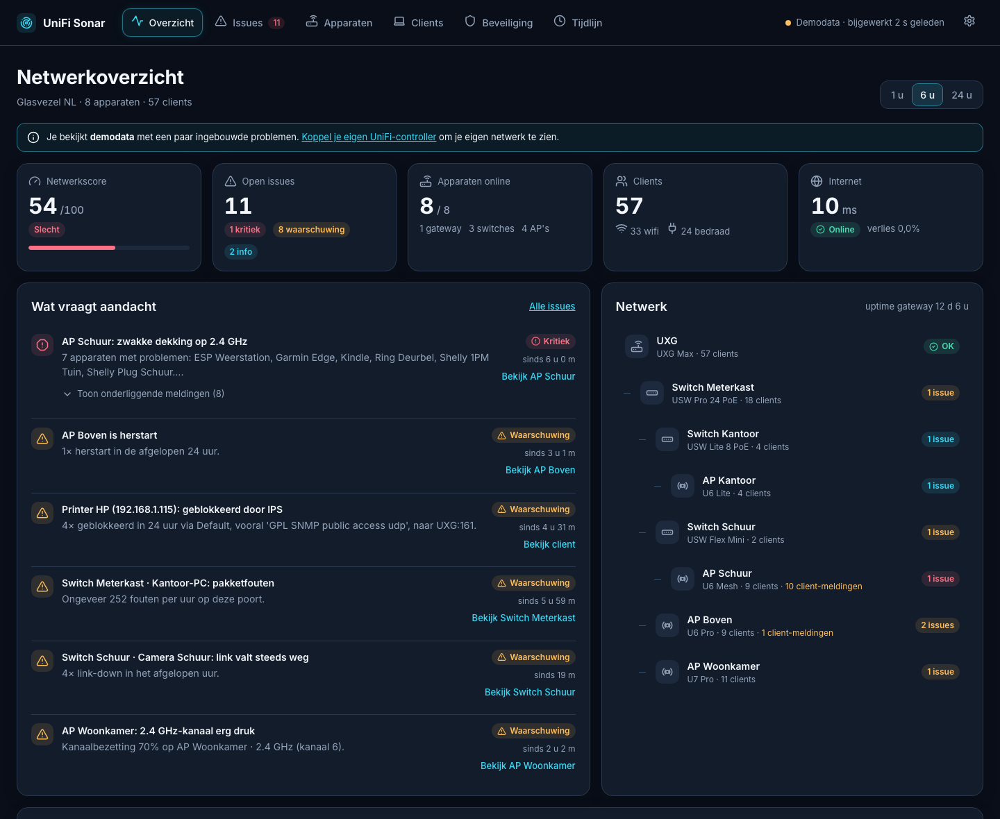

## Wat het kan

- **Overzicht:** netwerkscore, open meldingen, je netwerk als boom (gateway → switches → AP's), wifi per access point en grafieken van internetlatency en wifi-ervaring.
- **Slimme meldingen:**
  - zwak signaal (met aparte drempels voor 2,4 en 5/6 GHz), veel retries, slechte ervaringsscore, apparaten die steeds van AP wisselen
  - drukke kanalen en storing van buren, overlappende 2,4 GHz-kanalen, een overbelaste AP
  - pakketfouten op switchpoorten, links die wegvallen, gigabitpoorten die op 100 Mbit draaien, een bijna vol PoE-budget
  - herstarts, offline apparaten, firmware-updates, hoge CPU, geheugen of temperatuur; geen alarm terwijl een apparaat wordt bijgewerkt, en een herstart door een firmware-update telt niet als probleem
  - internetlatency, pieken en pakketverlies
  - **groepering op oorzaak:** hebben meerdere apparaten op dezelfde AP problemen, dan wordt dat één melding "zwakke dekking". Valt (bijna) alles tegelijk weg, dan krijg je één melding dat de controller niets meer hoort, in plaats van tien losse
  - **"blijft hangen":** vaste apparaten die al lang met zwak signaal op een verre AP zitten, terwijl ze de afgelopen week op een andere AP veel beter zaten. Ook na een herstart van een AP. Met een knop *Opnieuw verbinden*
  - **wifi-instellingen:** AP's in hetzelfde 5 GHz-kanaalblok, een ongebruikt 2.4 GHz-kanaal, 40 MHz op 2.4 GHz, band steering of Fast Roaming uit, trage minimale datasnelheid, een te strenge minimum-RSSI en hoog zendvermogen op 2.4 GHz
  - **open naar internet:** UPnP aan, UPnP-mappings op standaardpoorten, SSH/RDP/databases die voor iedereen openstaan en port forwards die vaak worden aangevallen
  - **IPS:** een eigen apparaat dat door de IPS wordt geblokkeerd, krijgt een melding (aanvallen van buiten zijn juist het werk van de IPS)
- **Nieuwe apparaten:** verschijnt er een apparaat dat Sonar nog nooit zag, dan krijg je een melding (ook als pushbericht) met fabrikant, netwerk en AP. Met *Ken ik* keur je het goed. Apparaten met een **wisselend privé-wifiadres** herkent Sonar aan hun hostnaam; dan krijg je een tip om het adres op *vast* te zetten, want anders begint de historie steeds opnieuw. Bij de eerste start worden alle bestaande apparaten stil goedgekeurd.
- **Meldingen versturen** naar Home Assistant, ntfy, Discord, Slack of een eigen webhook. Pas na een instelbare wachttijd (geen bericht bij één uitschieter), een nieuw bericht als het erger wordt, een bericht als het is opgelost, veel tegelijk wordt één bundel, en desgewenst een dagoverzicht. Ook als de controller onbereikbaar is.
- **Meldingen negeren** voor 1 dag, 1 week, 30 dagen of altijd, bijvoorbeeld een laadpaal die nu eenmaal op 100 Mbit draait. IPS-blokkades negeer je per adres, per regel of de combinatie.
- **Dit apparaat:** op het overzicht zie je meteen hoe het apparaat waarmee je kijkt verbonden is: welke AP, band en kanaal, signaal, snelheid en hoe vaak het vandaag van AP wisselde, met een knop om opnieuw te verbinden.
- **Internet:** live download- en uploadverkeer, latency, het verkeer over de afgelopen dagen, je **datagebruik per dag en per maand** (met een verwachting voor de hele maand) en een **speedtest** met één knop. De test draait op je gateway zelf, dus hij meet je echte internetverbinding en niet je wifi. Alle resultaten blijven bewaard, en zakt de snelheid ver onder wat normaal is voor jouw verbinding, dan krijg je een melding.
- **Wereld:** een live wereldkaart van alle verbindingen door je gateway. Bogen naar elk land waar je apparaten mee praten, inkomend verkeer en wat de IPS of je regioblokkade tegenhield, met per land de belangrijkste domeinen en apparaten, en bij blokkades welke dienst en welk apparaat het doelwit was. Kies tussen een platte kaart en een draaiende 3D-globe tegen een sterrenhemel. Inzoomen kan met scrollen, slepen, knijpen of door op een land in de lijst te klikken. Klik op een van de tegels bovenaan voor de lijst met verbindingen, samengevoegd per apparaat en bestemming en te doorzoeken. De gegevens komen uit het verkeerslogboek dat UniFi zelf al bijhoudt: geen NetFlow, geen GeoIP-database en geen extra software nodig.
- **Internetstoringen:** beschikbaarheid over 24 uur, 7, 30 en 90 dagen en per maand, met een lijst van alle storingen en hoe lang ze duurden. UniFi zelf toont internetgebeurtenissen maar 24 uur; Sonar bewaart ze, handig als je je provider wilt bellen. Viel het internet weg, dan krijg je een melding.
- **Verbruik per apparaat:** wie de meeste data gebruikt, vandaag, de afgelopen 7 of 30 dagen, en per apparaat een grafiek per dag. Staat 'Traffic Identification' aan in UniFi, dan ook per categorie (video, games, updates…).
- **DNS-lekken:** apparaten die om je eigen DNS-server (AdGuard, Pi-hole) heen gaan met gewone DNS, DNS-over-TLS of DNS-over-HTTPS, zodat je filters daar niet werken. Je DNS-server zelf (die naar buiten mag) telt niet mee.
- **Firewall-audit:** regels die nooit aan de beurt komen omdat een eerdere regel alles afvangt, en toestaan-regels die een apart netwerk (IoT, gasten) of internet onbeperkt bij je hoofdnetwerk laten.
- **Mislukte wifi-verbindingen:** hoeveel verbindingspogingen per band lukten en in welke stap het misging (inloggen, IP-adres, DNS), met advies per oorzaak. Ook wat UniFi zelf opviel per apparaat (trage DNS, hoge vertraging, pakketverlies, slapende clients).
- **Wifi in de buurt en kanaaladvies:** per access point hoe druk elk kanaal is door buren en je eigen AP's, plus storing die Sonar daar eerder heeft gemeten (ook storing die niet van wifi komt). Is er een duidelijk rustiger kanaal, dan krijg je een tip.
- **Vaste pauzetijden:** groepen apparaten (bijvoorbeeld 'Kinderen') op gekozen dagen tussen twee tijden zonder internet, ook over middernacht heen. Sonar blokkeert ze in UniFi en laat ze daarna vanzelf weer toe.
- **Wifi-snelheid op deze plek:** meet vanaf je telefoon of laptop de snelheid naar Sonar, dus je wifi zelf, met de kamer, de AP, de band en het signaal erbij.
- **Beveiligingsadviezen van Ubiquiti:** Sonar haalt elke 6 uur de openbare lijst op en vergelijkt die met de firmware van je access points, switches, gateway en de Network-app. Geldt een advies voor jou, dan krijg je een melding met de versie die het oplost. Er gaat niets van jouw netwerk mee, en je kunt het uitzetten.
- **Publiek IP-adres gewijzigd:** op de tijdlijn en als melding, handig bij dynamische DNS of een VPN.
- **Patronen:** per apparaat de favoriete AP, hoe lang het op elke AP zat en wanneer het verbonden is (per uur van de week); per access point hoe druk elk kanaal is per uur van de week.
- **Wijzigingslog:** elke wijziging in je instellingen komt op de tijdlijn, zoals "Wifi 'Thuis': Fast Roaming uit → aan" of "AP Woonkamer · 2.4 GHz kanaal: 11 → 6". Sonar volgt wifi-netwerken, netwerken en VPN-servers, port forwards, firewallregels, algemene instellingen (UPnP, spanning tree, IPS) en per apparaat de kanalen, breedte, zendvermogen en band steering. Van een wifi-wachtwoord bewaart Sonar alleen een gezouten hash, zodat er "wachtwoord gewijzigd" kan staan.
- **Netwerkscheiding:** je netwerken (VLAN's) met hun firewallzone en hoeveel apparaten erop zitten, plus een diagram van wat er tussen je netwerken, de gateway en internet mag: kies een netwerk en je ziet zijn pijlen (mag, deels of geblokkeerd), kies een pijl en je ziet precies wat wel en niet mag en welke regels dat bepalen (bijvoorbeeld "IoT → Default: wel Home Assistant en DNS, niet al het andere"). Port forwards tellen mee. Liever een tabel per firewallzone? Die staat er ook. Sonar herkent slimme apparaten aan hun fabrikant of hostnaam (Espressif, Tuya, Shelly, Tasmota, ESPHome en meer) en meldt het als er een op je hoofdnetwerk staat terwijl je er een apart netwerk voor hebt, met uitleg hoe je het verhuist. Zit je IoT-netwerk in dezelfde zone als je hoofdnetwerk, dan krijg je een waarschuwing dat het niet afgeschermd is. Heb je nog geen apart netwerk, dan krijg je één tip. Hoort een apparaat bewust op het hoofdnetwerk? Kies *Negeren → Altijd*.
- **Netwerkkaart:** gateway, switches en access points als boom, met per verbinding de poort en snelheid (trager dan 1 Gbit/s valt op) en desgewenst alle clients als stippen, gekleurd naar signaal.
- **Internet pauzeren** per apparaat: 30 minuten, 1 of 2 uur, tot morgen 07:00 of tot je hervat. Sonar blokkeert het apparaat dan in UniFi en laat het vanzelf weer toe als de tijd om is.
- **Home Assistant via MQTT:** netwerkscore, meldingen, clients, latency, live internetverkeer, speedtest, datagebruik, nieuwe apparaten en IPS-blokkades als sensoren, plus een knop om een speedtest te starten. Home Assistant herkent alles vanzelf (MQTT-discovery).
- **Pagina's** voor apparaten (radio's, poortenraster, PoE, historie), clients (signaal, retries, ervaring en roaming per apparaat), beveiliging (IPS, netwerkscheiding, wat er openstaat naar internet en VPN-servers die zichtbaar zijn voor scanners) en een tijdlijn met gebeurtenissen.
- **Probleemoplossing:** één knop kopieert de versie, het controllertype en de laatste fouten, zonder adressen, namen of sleutels, zodat je die in een GitHub-issue kunt plakken.
- **Demomodus** met een nagebootst netwerk, zodat je zonder controller kunt rondkijken.
- **Nederlands of Engels:** wissel met **NL | EN** in de bovenbalk of onder *Instellingen → Taal*. De taal geldt voor het dashboard, alle meldingen en adviezen, berichten naar je telefoon en de sensornamen in Home Assistant. Meldingen en de tijdlijn worden in beide talen bewaard, dus ook de historie wisselt mee. Bij de eerste start volgt Sonar de taal van je browser.

## Screenshots

Alle screenshots tonen de ingebouwde demodata.

| | |
|---|---|
| 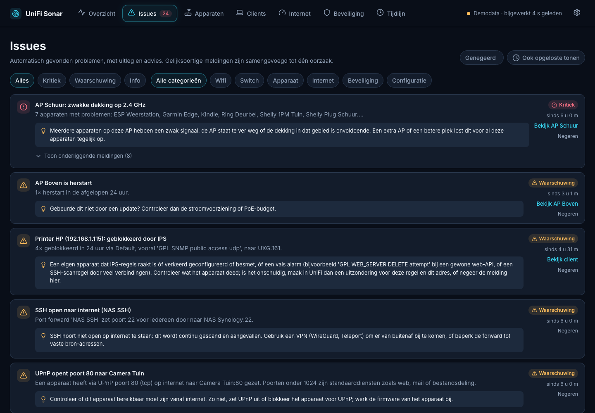 | 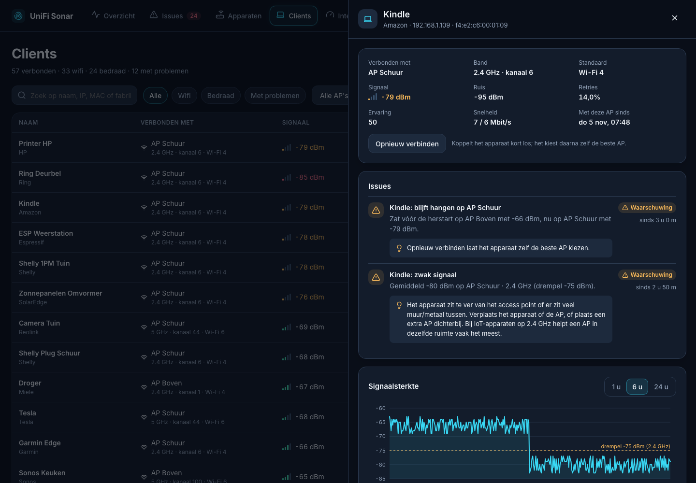 |
| **Issues:** elke melding met uitleg en advies, gegroepeerd op oorzaak | **Clientdetail:** de Kindle bleef na een herstart van AP Boven hangen op de verre AP Schuur |
| 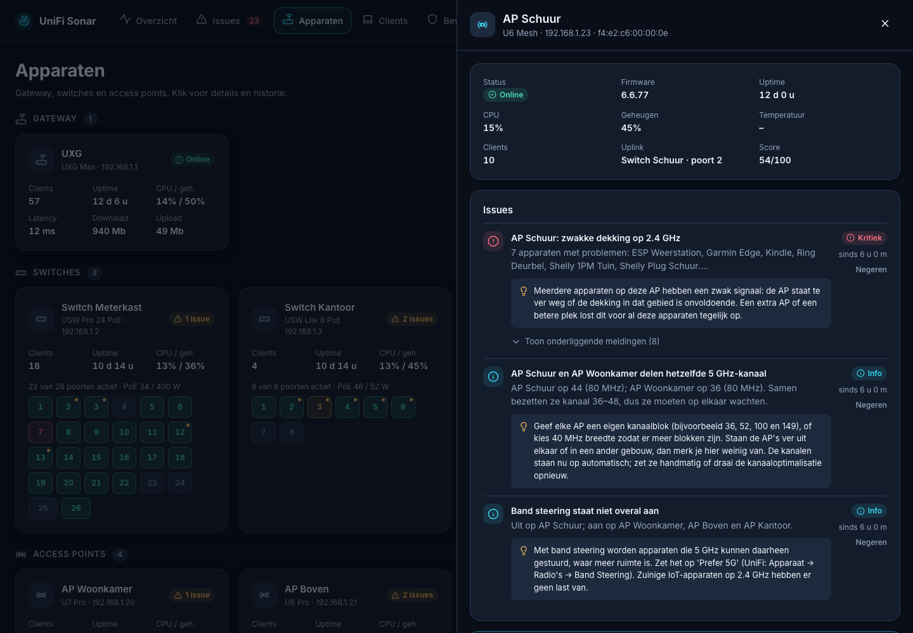 | 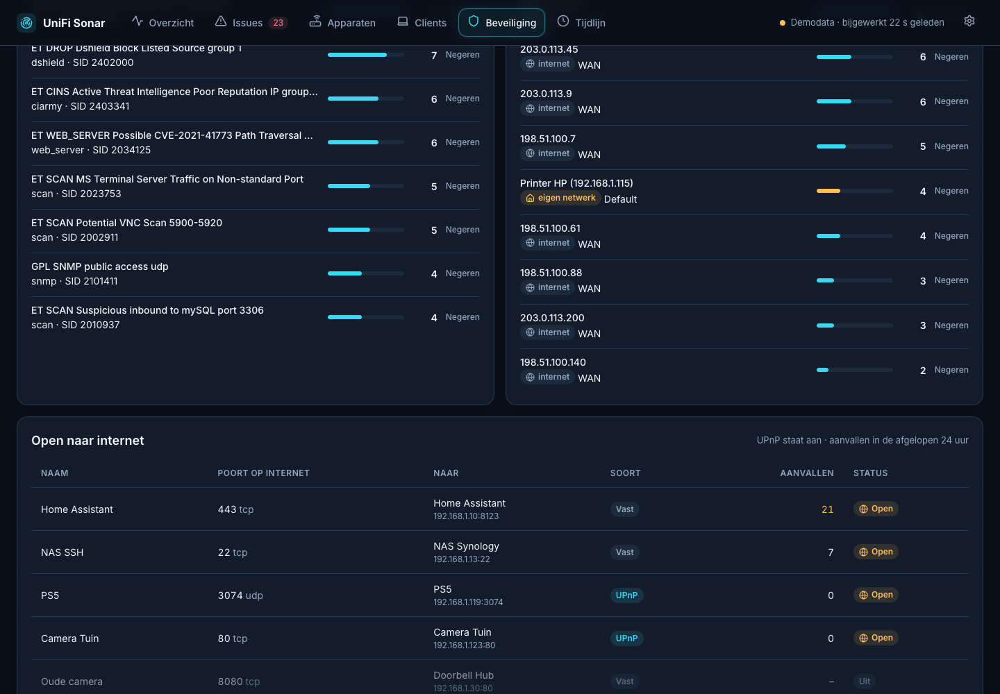 |
| **Access point:** dekkingsprobleem, radio's, kanaalbezetting en historie | **Beveiliging:** wat de IPS tegenhield en welke poorten openstaan, met het aantal aanvallen per poort |
| 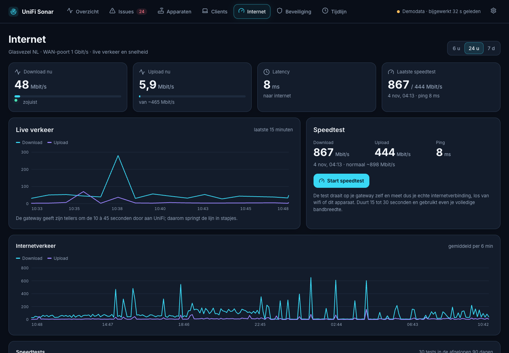 | 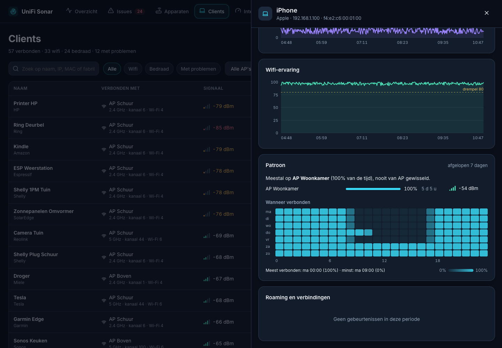 |
| **Internet:** live verkeer en een speedtest vanaf de gateway | **Patronen:** favoriete AP en wanneer een apparaat thuis is |
| 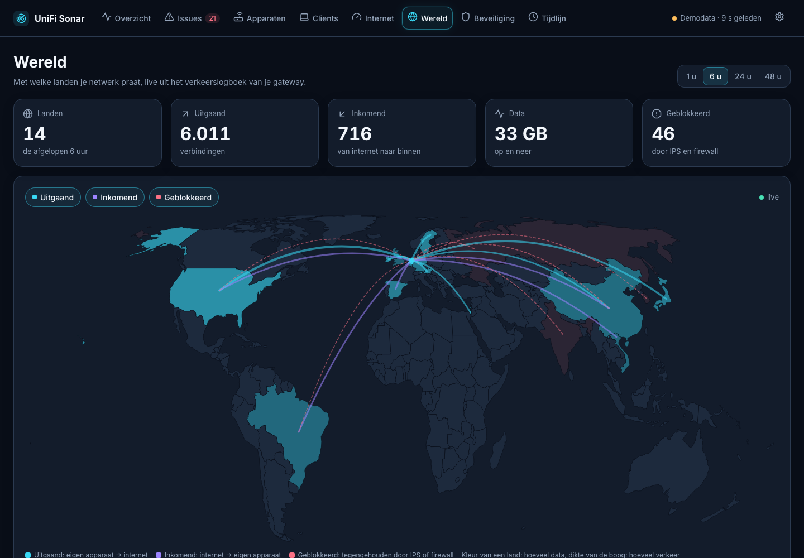 | 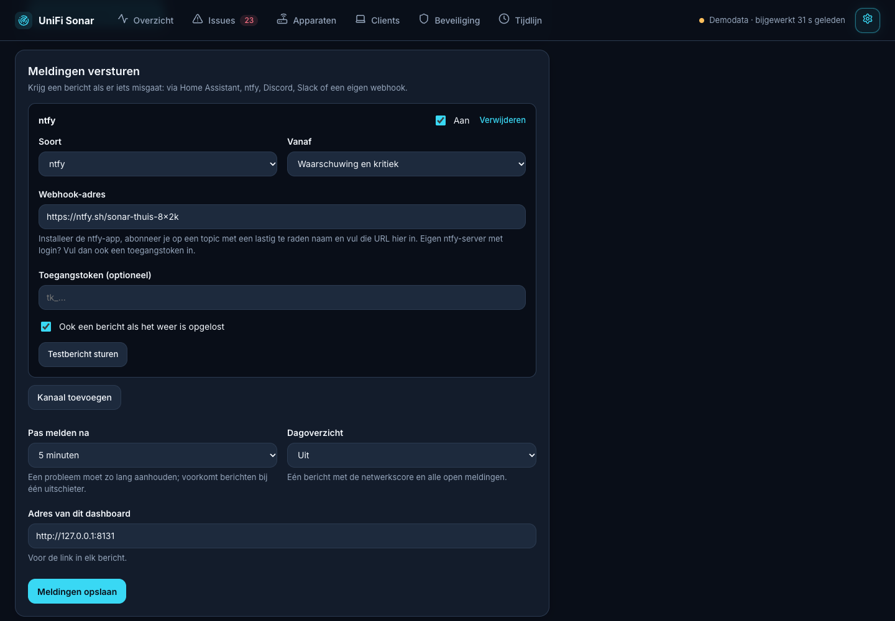 |
| **Wereld:** met welke landen je netwerk praat, live | **Meldingen versturen** naar je telefoon, Home Assistant of Discord |
| 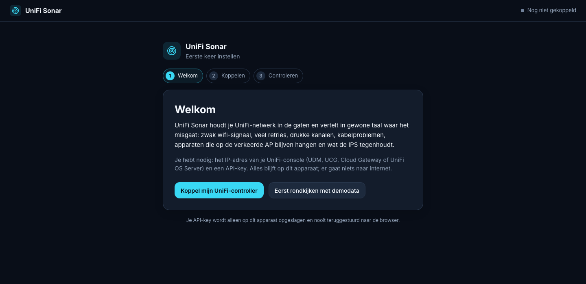 | 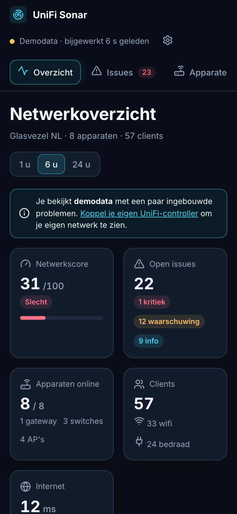 |
| **Setup-wizard** bij de eerste start | **Ook op je telefoon** |

## Wat je nodig hebt

- Een UniFi-console met de **Network**-app: Dream Machine, Dream Router, Cloud Gateway (UCG), Cloud Key Gen2+ of de zelf-gehoste **UniFi OS Server**.
- Een **API-key**: in UniFi Network via *Instellingen → Control Plane → Integrations → Create API Key*.
- Een kleine Linux-machine die altijd aan staat, bijvoorbeeld een **Proxmox-LXC**, een Raspberry Pi of een andere Debian/Ubuntu-machine. Het gebruikt ongeveer 50 MB geheugen.

Geeft je API-key alleen beperkte gegevens (geen signaal of retries per client)? Dan kun je in de wizard onder *Geavanceerd* ook een lokaal UniFi-account met **View Only**-rechten opgeven.

## Installeren

### Proxmox (aanbevolen)

Draai dit op je **Proxmox-host**, in de shell van de node:

```bash
bash -c "$(curl -fsSL https://raw.githubusercontent.com/lexi1986/unifi-sonar/main/scripts/proxmox-lxc.sh)"
```

Het script vraagt een paar dingen, zoals de container-ID, het IP-adres (DHCP of vast) en de opslag. Op alles kun je Enter drukken voor de standaardwaarde. Daarna maakt het een kleine Debian-container aan (1 core, 512 MB, 4 GB), installeert UniFi Sonar erin en toont het adres.

De container heeft **geen root-wachtwoord**. Open je hem in Proxmox via *Console*, dan ben je meteen ingelogd, net als bij de Proxmox community-scripts. Vanaf de host kan het ook met `pct enter <container-id>`. Wil je toch een wachtwoord, bijvoorbeeld voor SSH, stel het dan in met `pct exec <container-id> -- passwd`.

### Debian, Ubuntu of Raspberry Pi OS

```bash
curl -fsSL https://raw.githubusercontent.com/lexi1986/unifi-sonar/main/scripts/install.sh | sudo bash
```

Standaard draait het dashboard op poort 80. Wil je een andere poort, dan zet je `PORT=8080` vóór `bash`:

```bash
curl -fsSL https://raw.githubusercontent.com/lexi1986/unifi-sonar/main/scripts/install.sh | sudo PORT=8080 bash
```

### Eerste keer openen

Ga naar `http://<ip-van-de-machine>`. De **setup-wizard** vraagt:

1. het adres van je UniFi-console. Poort 443 en 11443 (UniFi OS Server) worden allebei geprobeerd.
2. je **API-key**.

De wizard test de verbinding, laat zien wat hij vindt (gateway, aantal apparaten en clients) en start daarna met meten. Na een paar minuten verschijnen de eerste meldingen; na een dag historie zijn ze het nauwkeurigst.

### Meldingen op je telefoon

Onder *Instellingen → Meldingen versturen* (het tandwiel rechtsboven) voeg je een kanaal toe:

- **Home Assistant:** maak een automatisering met als trigger *Webhook* en plak de webhook-URL. In de automatisering gebruik je `trigger.json.title`, `trigger.json.message` en `trigger.json.severity`, bijvoorbeeld voor een melding via de Companion-app.
- **ntfy:** installeer de ntfy-app, abonneer je op een topic met een lastig te raden naam en vul `https://ntfy.sh/<topic>` in (of je eigen ntfy-server, eventueel met toegangstoken).
- **Discord** of **Slack:** maak een webhook aan in het kanaal en plak de URL.
- **Eigen webhook:** krijgt JSON met `event`, `severity`, `title`, `message`, `url` en `key`, handig voor n8n of Node-RED.

Met *Testbericht sturen* zie je direct of het aankomt. Wat al openstond toen je het kanaal toevoegde, wordt niet alsnog verstuurd.

## Bijwerken

Je instellingen en historie blijven bij bijwerken altijd staan.

**In een Proxmox-container:** open de console van de container en typ:

```bash
update
```

Het commando kijkt of er een nieuwe versie op GitHub staat, laat zien wat er veranderd is en werkt alles bij. Bij het inloggen in de container zie je ook welke versie draait en op welk adres. Vanaf de Proxmox-host kan het ook:

```bash
pct exec <container-id> -- update
```

**Op Debian, Ubuntu of een Raspberry Pi:**

```bash
sudo unifi-sonar-update
```

Met `--check` kijk je alleen of er een update is; met `--force` installeer je opnieuw, ook als je al de nieuwste versie hebt. De poort die je bij het installeren koos, blijft behouden.

Heb je UniFi Sonar geïnstalleerd vóór versie 1.2? Draai dan één keer het installatiecommando opnieuw (of `pct exec <container-id> -- bash /root/install-unifi-sonar.sh`). Daarna is `update` beschikbaar.

## Privacy en veiligheid

- Alles blijft op je eigen machine. Er gaat niets naar internet, behalve het downloaden van de software bij installeren en bijwerken, de meldingen naar de diensten die je zelf instelt, en elke 6 uur het ophalen van de openbare lijst met beveiligingsadviezen van Ubiquiti (daarbij gaat niets van jouw netwerk mee; uit te zetten op de pagina Beveiliging).
- UniFi Sonar **verandert geen instellingen** in UniFi. De enige acties zijn *Opnieuw verbinden* voor één wifi-apparaat, een speedtest op de gateway starten, en *Pauzeren* en *Vaste pauzetijden*: die blokkeren apparaten in UniFi tot de gekozen tijd om is.
- De wifi-meting vanaf je telefoon of laptop gaat alleen tussen dat apparaat en Sonar, niet naar internet.
- Gebruik je de koppeling met Home Assistant, dan staan het adres en de inloggegevens van de MQTT-broker alleen in `config.json`. De browser krijgt het wachtwoord nooit terug.
- De API-key en de webhook-adressen staan alleen in `/var/lib/unifi-sonar/config.json`, en alleen de service kan dat bestand lezen. De browser krijgt de sleutel nooit terug en ziet van webhook-adressen alleen het begin.
- Het dashboard heeft **geen login**. Iedereen in je netwerk die het adres kent, kan meekijken, meldingen negeren en een wifi-apparaat opnieuw laten verbinden. Zet het daarom niet open naar internet.
- Het dashboard antwoordt alleen op een IP-adres, `localhost` en lokale namen (`.local`, `.lan`, `.home`, `.internal`, `.home.arpa`). Zo kan een website die je bezoekt het dashboard niet via je browser aansturen (DNS-rebinding). Acties vanaf een andere website worden ook geweigerd. Gebruik je een eigen hostnaam of een reverse proxy, voeg die dan toe onder *Instellingen → Toegang*, of zet `Environment=ALLOWED_HOSTS=sonar.mijndomein.nl` in de service.
- De koppeling wijzigen kan alleen als je de huidige API-key invult.
- Voor de wereldkaart bewaart UniFi Sonar de verbindingen uit het verkeerslogboek van UniFi (welk apparaat met welk domein en land praatte) **48 uur** in de lokale database. Daarna worden ze verwijderd.
- Gebruik je de IPS van je UniFi-gateway en kijk je via een VPN? UniFi Sonar gebruikt bewust geen HTTP `DELETE`, omdat de IPS dat als aanval kan zien (regel 2101603).

## Drempels aanpassen

De standaardwaarden staan in [`app/config.py`](app/config.py) en zijn afgestemd op een gewoon thuisnetwerk. Overschrijven kan per drempel:

```bash
sudo systemctl edit unifi-sonar
```

Zet daarin bijvoorbeeld:

```ini
[Service]
Environment=TH_CLIENT_RETRY_WARN=30
Environment=TH_CLIENT_SIGNAL_WARN_24=-78
```

Daarna `sudo systemctl restart unifi-sonar`.

## Verwijderen

```bash
sudo systemctl disable --now unifi-sonar
sudo rm -rf /opt/unifi-sonar /var/lib/unifi-sonar /etc/systemd/system/unifi-sonar.service
sudo userdel unifi-sonar
```

Of verwijder in Proxmox gewoon de container.

## Ontwikkelen

```bash
python3 -m venv .venv && .venv/bin/pip install -r requirements-dev.txt
.venv/bin/uvicorn app.main:app --reload --port 8088   # wizard → "Eerst rondkijken met demodata"
.venv/bin/python -m pytest -q
```

| Map/bestand | Rol |
|---|---|
| `app/unifi_client.py` | Uitlezen van UniFi OS (uitgebreide API, officiële API, IPS-flows) en één datamodel |
| `app/collector.py` | Elke minuut meten, delta's berekenen (retries, fouten, throughput), events |
| `app/rules.py` | Alle meldingen, groepering op oorzaak en scores |
| `app/notify.py` | Meldingen versturen (Home Assistant, ntfy, Discord, Slack, webhook) |
| `app/changes.py` | Wijzigingslog: vingerafdruk van de instellingen en leesbare verschillen |
| `app/ha_mqtt.py` | Home Assistant-koppeling via MQTT (kleine eigen MQTT 3.1.1-client, discovery) |
| `app/setup.py` | Verbindingstest voor de wizard |
| `app/mock.py` | Nagebootst netwerk met ingebouwde problemen (demomodus) |
| `web/` | Dashboard (vanilla JS, geen build-stap) |
| `web/world.js`, `web/world-geo.js` | Landsgrenzen voor de platte kaart en de globe, gemaakt met `tools/make_world.py` uit Natural Earth |
| `web/globe.js` | De 3D-globe (canvas), met [d3-geo](https://d3js.org/d3-geo) uit `web/vendor/` (ISC-licentie) |
| `scripts/` | Installeren (Linux, Proxmox), bijwerken (`update.sh`, wordt het commando `update`) en `dev-deploy.sh` om lokale code naar een test-LXC te zetten |

Ideeën en verbeteringen zijn welkom via issues en pull requests. Plak bij een probleem de debug-info uit *Instellingen → Probleemoplossing*.

Een aantal ideeën is geïnspireerd door [Network Optimizer](https://github.com/Ozark-Connect/NetworkOptimizer), [UI Toolkit](https://github.com/Crosstalk-Solutions/unifi-toolkit) en [Lagezentrum (unifi-HQ)](https://github.com/ProfessorQuantumUniverse/unifi-HQ); er is geen code van overgenomen. De landsgrenzen komen van [Natural Earth](https://www.naturalearthdata.com) (publiek domein); de globe gebruikt [d3-geo en d3-array](https://d3js.org) (ISC-licentie, zie `web/vendor/LICENSE-d3.txt`).

## Licentie

[MIT](LICENSE)
