# UniFi Sonar

**English** · [Nederlands](README.nl.md)

**UniFi shows you what's happening. Sonar tells you what's wrong, and how to fix it.**

https://github.com/user-attachments/assets/34b1aa13-3308-484a-9929-21cc42bd724a

UniFi Sonar is a self-hosted dashboard for your UniFi network. It reads your controller (gateway, switches, access points and every client), keeps a few weeks of history and hunts for problems on its own: weak Wi-Fi, devices stuck on a far-away access point, busy channels, flaky cables, devices that bypass your Pi-hole or AdGuard, firewall rules that don't do what you think, Ubiquiti security advisories for your exact firmware, and more. Every issue comes with a plain-language explanation and a concrete fix, and it can ping your phone or Home Assistant.

<p align="center">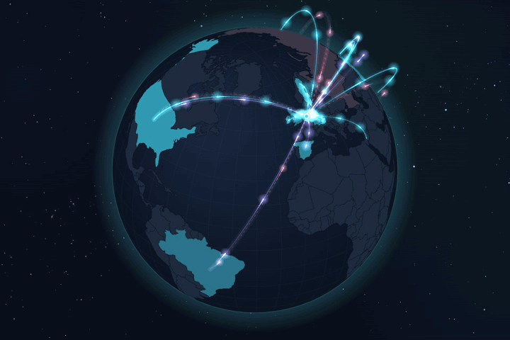</p>

> Unofficial hobby project. Not affiliated with or endorsed by Ubiquiti. "UniFi" is a trademark of Ubiquiti Inc.

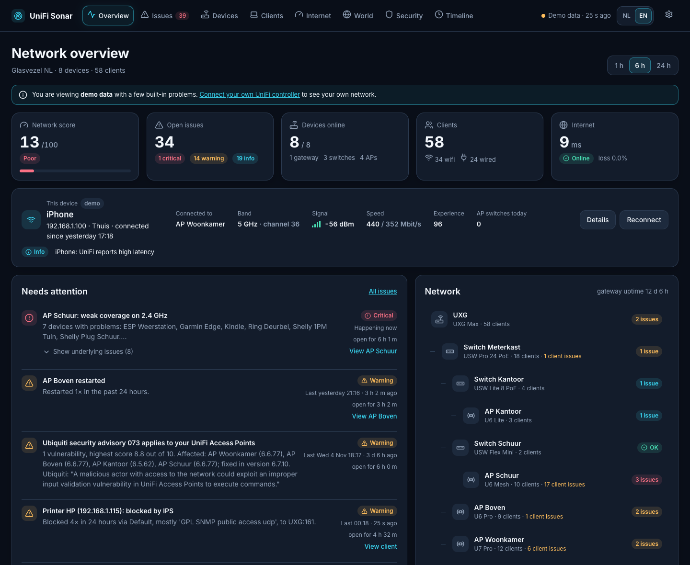

## Why Sonar?

| | UniFi Network app | Grafana stack (e.g. UnPoller) | **UniFi Sonar** |
|---|---|---|---|
| Shows the raw numbers | ✓ | ✓ | ✓ |
| Tells you *what* is wrong, grouped by cause | partly | – | ✓ |
| Tells you *how to fix it*, step by step | – | – | ✓ |
| Remembers history (outages, roaming, changes) | short | ✓ | ✓ |
| Setup | built in | exporter + database + dashboards | one command, wizard in the browser |
| Notifications with "resolved" messages | limited | via alert rules | ✓ built in |

Sonar doesn't replace your controller; it sits next to it and does the thinking. It runs in a tiny Proxmox LXC or on a Raspberry Pi (about 50 MB of RAM) and works in **English and Dutch**.

## What it finds

**Wi-Fi and roaming**
- Weak signal (separate thresholds for 2.4 and 5/6 GHz), high retries, low experience scores, devices that keep hopping between APs.
- **"Stuck" devices:** a fixed device that has been on a distant AP with poor signal for a long time, while it did much better on another AP last week, typically after an AP restart. One click reconnects it.
- Busy channels and interference, overlapping 2.4 GHz channels, an overloaded AP, and **failed connection attempts** per band with the step where it went wrong (authentication, DHCP or DNS).
- **Neighbouring networks and channel advice:** per AP how busy each channel is, including non-Wi-Fi interference Sonar measured there before. If a clearly quieter channel exists, you get a tip.
- **Wi-Fi settings that slow you down:** APs sharing a 5 GHz block, 40 MHz on 2.4 GHz, band steering or fast roaming off, high minimum data rates, a too-strict minimum RSSI.
- **Grouping by cause:** five weak clients on one AP become one "weak coverage" issue, and if everything drops at once you get one "controller hears nothing" issue instead of ten.

**Security**
- **DNS leaks:** devices that bypass your own DNS server (Pi-hole, AdGuard) with plain DNS, DNS-over-TLS or DNS-over-HTTPS, so your filters don't apply to them.
- **Firewall audit:** rules that never match because an earlier rule catches everything, and allow rules that open your main network to IoT, guests or the internet.
- **Ubiquiti security advisories** matched against the firmware of your APs, switches, gateway and Network app, with the version that fixes it.
- **AdGuard Home or Pi-hole** (optional, read-only; Pi-hole version 6): what your smart devices and servers look up (with a notification for new domains after a week of learning), whether your DNS servers answer and agree with each other, malware and phishing that it blocked per device (critical when the IPS stepped in too), and devices that never ask it anything. With AdGuard Home also names for connections UniFi can't name; Pi-hole doesn't keep the answers needed for that.
- **Vulnerability check**: flaws that are really being exploited (CISA KEV), optionally your public address via Shodan InternetDB (each open port matched against your port forwards, UPnP and VPN servers), and a slow port check you start yourself. It always shows what was and wasn't looked at; smart devices are never probed.
- **Network segmentation:** your VLANs, their firewall zones and an interactive diagram of what may talk to what. Smart-home devices (Espressif, Tuya, Shelly, ESPHome…) on your main network are flagged.
- **What's open to the internet:** UPnP, port forwards on commonly attacked ports, exposed SSH/RDP/databases, and **IPS blocks of your own devices** (attacks from outside are the IPS doing its job; your own device being blocked deserves a look).
- **New devices** get a notification with vendor, network and AP. Devices with a rotating private Wi-Fi address are recognised by hostname.

**Internet**
- Live download and upload, latency, data usage per day and month (with a forecast), and a one-click **speed test that runs on the gateway** itself, so it measures your line and not your Wi-Fi.
- **Delay under load (bufferbloat):** during the speed test Sonar measures how much slower your line responds when it is full, and gives it a grade from A+ to F, so you know whether Smart Queues are worth turning on.
- **Outages and availability** over 24 hours, 7, 30 and 90 days and per month. UniFi keeps internet events for 24 hours; Sonar keeps them, which is handy when you call your provider.
- **Usage per device** for today, 7 or 30 days, and per category if Traffic Identification is on.
- **Public IP changed** on the timeline and as a notification.
- **Wi-Fi speed at this spot:** measure from your phone or laptop to Sonar, with the room, AP, band and signal recorded.

**The world map**
A live map, flat or as a rotating 3D globe, of every connection through your gateway: arcs to each country your devices talk to, incoming traffic, and what the IPS or your region block stopped. Per country you see the top domains and devices. It uses the traffic log UniFi already keeps: no NetFlow, GeoIP database or extra software.

**And also**
- **Change log:** every settings change lands on the timeline, like "Wi-Fi 'Home': Fast Roaming off → on" or "AP Living room · 2.4 GHz channel: 11 → 6".
- **Pause the internet** per device (30 minutes, 1 or 2 hours, until tomorrow) and **fixed pause times** for groups of devices ("Kids, school nights 21:00–07:00").
- **Quarantine**: block a device until you release it, with the reason next to it. Offered next to malware that your DNS filter blocked; schedules never let it go, and an issue reminds you while it lasts.
- **Devices without a name**: Sonar guesses what each one is from what it looks up, its vendor and its hostname ("Tuya plug, certain: looks up tuyaeu.com, vendor Tuya"), and you give it that name in UniFi with one click.
- **Patterns:** each device's favourite AP and when it is home, per hour of the week.
- **Notifications** to Home Assistant, ntfy, Discord, Slack or your own webhook, after a configurable delay, with an update when it gets worse and a message when it's resolved.
- **Home Assistant via MQTT:** network score, issues, clients, latency, live traffic, speed test and more as sensors, auto-discovered, plus a button to start a speed test. Choose phones or other devices to get them as a **`device_tracker`** (home or away), with a grace period for phones that briefly drop off the Wi-Fi.
- **Backups of your UniFi controller:** Sonar keeps a copy of the controller's automatic backups and can have a fresh one made every day, so you still have one when the controller crashes.
- **Required login** with a password under *Settings → Access*, and optionally a **passkey** (fingerprint, face or security key) next to it.
- **Wall display:** a calm full-screen view for a tablet, optionally with the globe, plus a black-and-white version for e-paper screens.
- **Demo mode** with a simulated network, so you can look around without a controller.

## Screenshots

All screenshots show the built-in demo data.

| | |
|---|---|
| 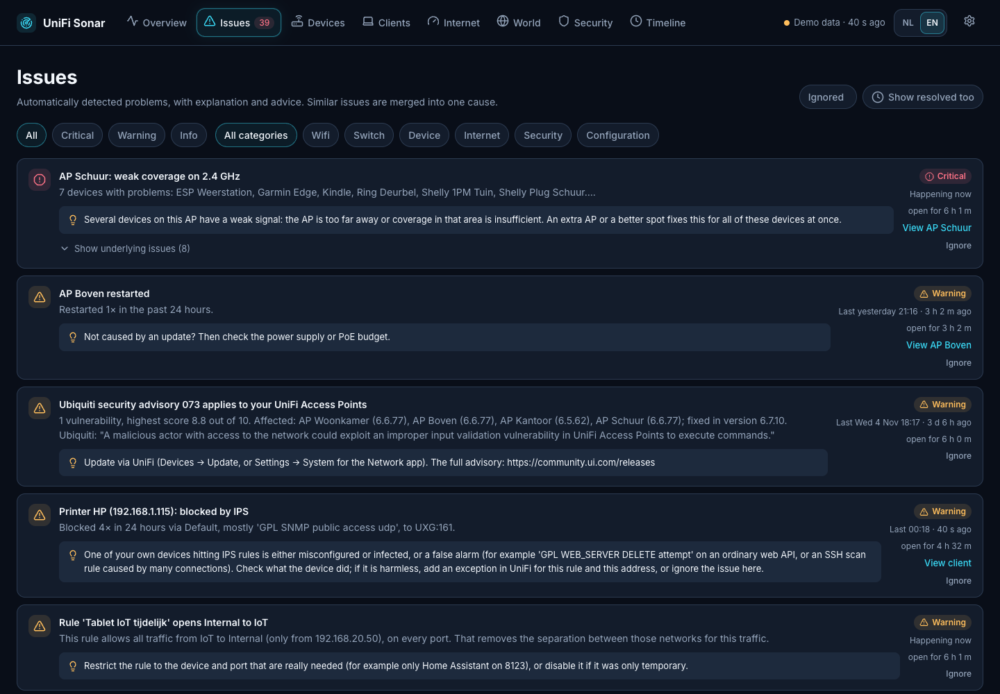 | 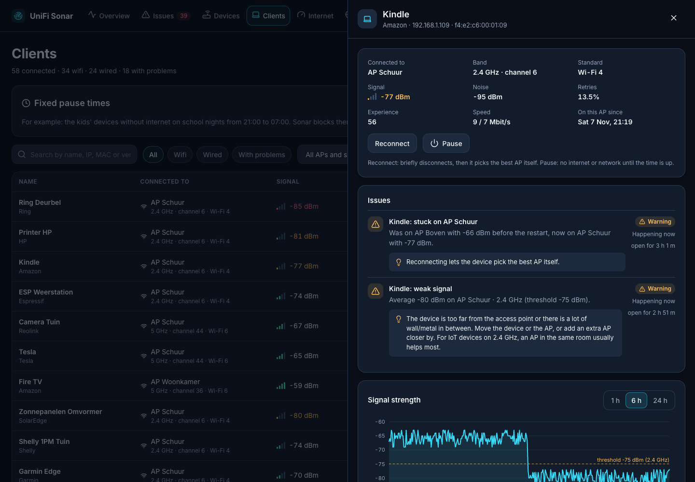 |
| **Issues:** every issue with an explanation and advice, grouped by cause | **Client detail:** the Kindle stayed on the distant AP after AP Boven restarted |
| 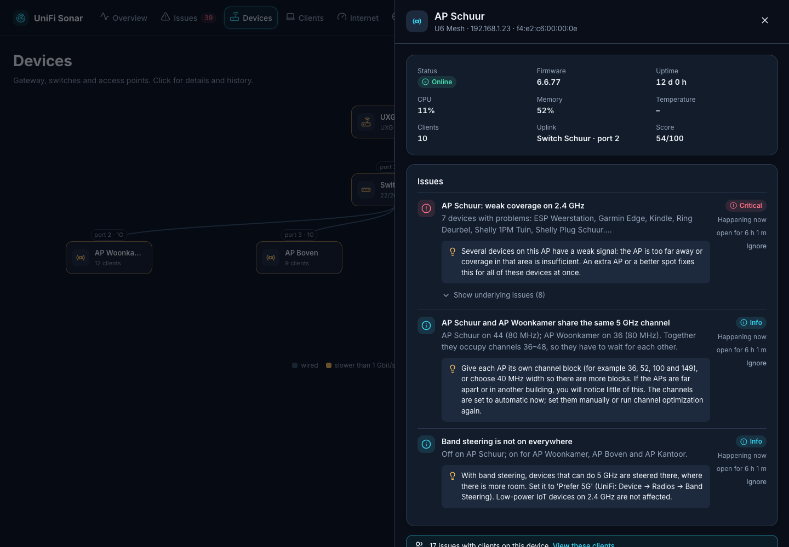 | 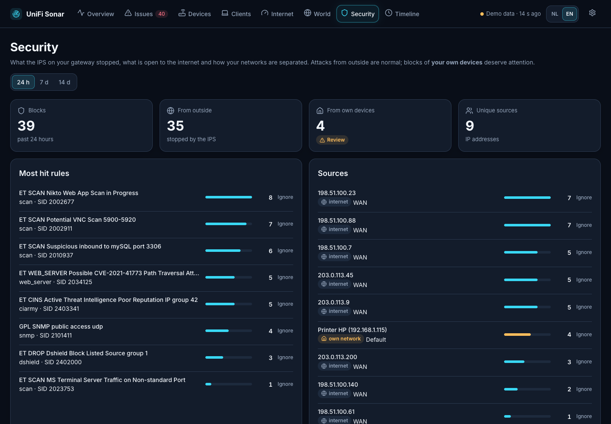 |
| **Access point:** coverage problem, shared channel block and band steering | **Security:** what the IPS stopped, the most hit rules and where it came from |
| 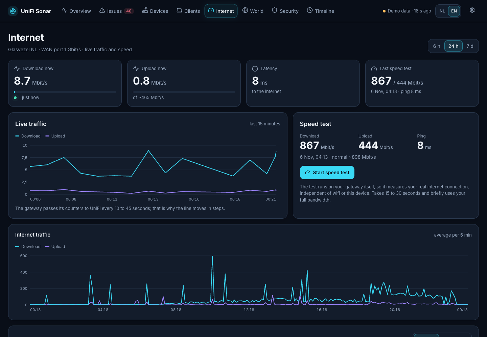 | 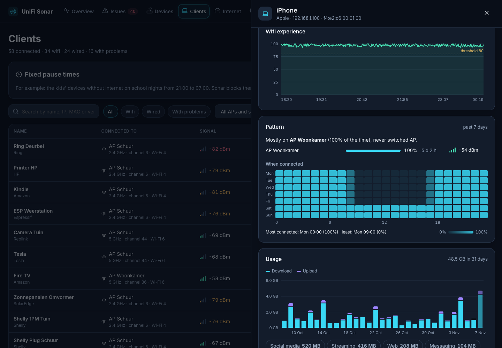 |
| **Internet:** live traffic and a speed test from the gateway | **Patterns:** favourite AP, when a device is home, usage per day |
| 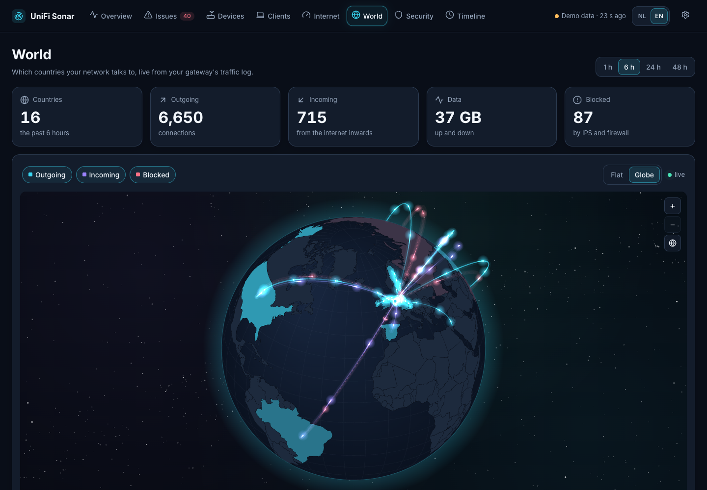 | 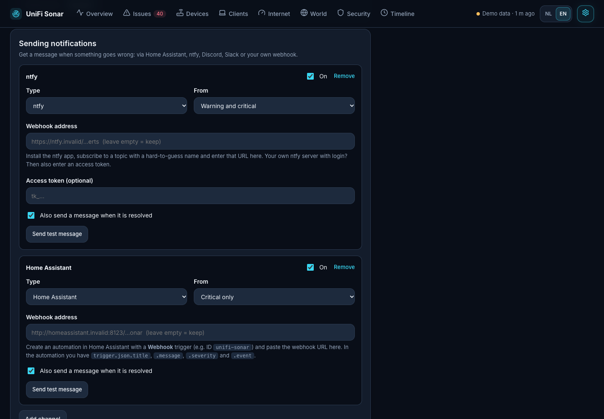 |
| **World:** which countries your network talks to, live | **Notifications** to your phone, Home Assistant or Discord |

<p align="center">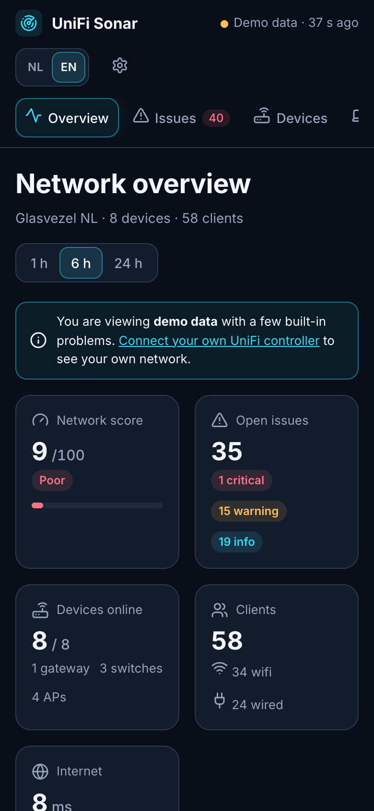<br><b>Works on your phone too</b></p>

## Requirements

- A UniFi console with the **Network** app: Dream Machine, Dream Router, Cloud Gateway (UCG), Cloud Key Gen2+ or the self-hosted **UniFi OS Server**.
- An **API key**: in UniFi Network under *Settings → Control Plane → Integrations → Create API Key*.
- A small always-on Linux machine: a **Proxmox LXC**, a Raspberry Pi or any Debian/Ubuntu machine. Sonar uses about 50 MB of RAM and makes a handful of API calls per minute (measured: about 400 an hour, a few seconds of controller time in total).

If your API key only returns limited data (no signal or retries per client), you can also enter a local UniFi account with **View Only** rights under *Advanced* in the wizard.

## Install

### Proxmox (recommended)

Run this in the shell of your **Proxmox host**:

```bash
bash -c "$(curl -fsSL https://raw.githubusercontent.com/lexi1986/unifi-sonar/main/scripts/proxmox-lxc.sh)"
```

The script asks a few questions (container ID, IP address via DHCP or static, storage); press Enter for the defaults. It creates a small Debian container (1 core, 512 MB, 4 GB), installs UniFi Sonar and shows the address.

The container has **no root password**: open it in Proxmox via *Console* and you're logged in, just like the Proxmox community scripts. From the host you can also use `pct enter <container-id>`. Want a password, for example for SSH? Set it with `pct exec <container-id> -- passwd`.

### Debian, Ubuntu or Raspberry Pi OS

```bash
curl -fsSL https://raw.githubusercontent.com/lexi1986/unifi-sonar/main/scripts/install.sh | sudo bash
```

The dashboard runs on port 80 by default. For another port, put `PORT=8080` before `bash`:

```bash
curl -fsSL https://raw.githubusercontent.com/lexi1986/unifi-sonar/main/scripts/install.sh | sudo PORT=8080 bash
```

### First start

Open `http://<ip-of-the-machine>`. The **setup wizard** asks for:

1. the address of your UniFi console (ports 443 and 11443 for UniFi OS Server are both tried);
2. your **API key**.

The wizard tests the connection, shows what it found (gateway, number of devices and clients) and starts measuring. The first issues appear after a few minutes; after a day of history they are at their most accurate. Prefer to look around first? Choose *Look around with demo data first*.

### Notifications on your phone

Under *Settings → Sending notifications* (the cog at the top right) add a channel:

- **Home Assistant:** create an automation with a *Webhook* trigger and paste the webhook URL. Use `trigger.json.title`, `trigger.json.message` and `trigger.json.severity`, for example for a Companion app notification.
- **ntfy:** install the ntfy app, subscribe to a hard-to-guess topic and enter `https://ntfy.sh/<topic>` (or your own ntfy server, optionally with an access token).
- **Discord** or **Slack:** create a webhook in the channel and paste the URL.
- **Your own webhook:** receives JSON with `event`, `severity`, `title`, `message`, `url` and `key`, handy for n8n or Node-RED.

*Send test message* shows straight away whether it arrives.

## Updating

Your settings and history are always kept.

**In a Proxmox container:** open the container console and type `update`. It checks GitHub for a new version, shows what changed and updates everything. From the Proxmox host: `pct exec <container-id> -- update`.

**On Debian, Ubuntu or a Raspberry Pi:** `sudo unifi-sonar-update`. Add `--check` to only check, or `--force` to reinstall.

Installed before version 1.2? Run the install command once more (or `pct exec <container-id> -- bash /root/install-unifi-sonar.sh`); after that `update` is available.

## Privacy and security

- **Everything stays on your machine.** Nothing goes to the internet except downloading the software when installing or updating, the notifications to services you set up yourself, and fetching two public lists: Ubiquiti's security advisories every 6 hours and CISA's list of exploited flaws once a day (nothing about your network is sent; you can switch both off on the Security page). Only if you turn it on, your public address is looked up at Shodan InternetDB once a day. During a speed test Sonar also briefly opens connections to `www.cloudflare.com` to measure the delay; no data is sent.
- **Sonar doesn't change your UniFi settings.** The only actions are *Reconnect* for one Wi-Fi device, starting a speed test on the gateway, *Pause*, *Fixed pause times* and *Quarantine*, which block a device in UniFi until the chosen time is up or you release it, and *Set name*, which gives a device a name in UniFi. If you turn it on, Sonar also asks the controller to make a backup. Everything else is read-only.
- **The query log of AdGuard or Pi-hole is in effect the browsing history of everyone at home.** Sonar therefore only keeps which domains smart devices and servers look up; for phones, laptops and tablets it only counts how much they look up, unless you change that. Blocked malware and phishing are kept for every device. Sonar only reads from AdGuard.
- The API key, webhook URLs and MQTT password live only in `/var/lib/unifi-sonar/config.json`, readable only by the service. The browser never gets the key back.
- With certificate verification off, Sonar pins your controller's certificate on first connection and won't send its key if the certificate changes; confirm a real change under *Settings → Access*. Updates only install published releases, and Python packages are checked against fixed hashes.
- **A login is required.** The first password needs a one-time code that is displayed after installing (or run `cat /var/lib/unifi-sonar/setup-code` on the machine). Only the demo works without a login. Under *Settings → Access* you can see logged-in devices and log them out. The password is only stored as a scrypt hash. Even with a login: **don't expose the dashboard to the internet.**
- Forgot the password? On the machine itself, run `cd /opt/unifi-sonar && sudo .venv/bin/python -m app.auth --reset` and then `sudo systemctl restart unifi-sonar`.
- **Passkeys** are optional; your password always keeps working. Browsers only allow them over HTTPS with a host name, so not on a plain `http://` IP address. Put Sonar behind a reverse proxy that sets `X-Forwarded-Proto` and add the name under *Settings → Access*. Sonar only stores the public key.
- **Backups** contain your whole UniFi configuration, including Wi-Fi passwords. They are stored in `/var/lib/unifi-sonar/backups`, readable only by the service, and **encrypted**: Sonar can write them, but only your password or a recovery code (shown once) can open them. Lose both and existing backups can no longer be opened. Sonar keeps the newest 30. They live on the machine that runs Sonar, so run Sonar on different hardware from your controller if you want to survive a failure of that machine too.
- The dashboard only answers to an IP address, `localhost` and local names (`.local`, `.lan`, `.home`, `.internal`, `.home.arpa`), so a website you visit can't control it through your browser (DNS rebinding), and actions from other websites are refused. Using your own hostname or a reverse proxy? Add it under *Settings → Access*.
- For the world map, Sonar keeps the connections from UniFi's traffic log (which device talked to which domain and country) for **48 hours** in its local database.
- Using the IPS on your UniFi gateway and viewing through a VPN? Sonar deliberately avoids HTTP `DELETE`, because the IPS can see that as an attack (rule 2101603).

## Tuning thresholds

The defaults live in [`app/config.py`](app/config.py) and suit a normal home network. Override any of them:

```bash
sudo systemctl edit unifi-sonar
```

```ini
[Service]
Environment=TH_CLIENT_RETRY_WARN=30
Environment=TH_CLIENT_SIGNAL_WARN_24=-78
```

Then `sudo systemctl restart unifi-sonar`.

## Uninstall

```bash
sudo systemctl disable --now unifi-sonar
sudo rm -rf /opt/unifi-sonar /var/lib/unifi-sonar /etc/systemd/system/unifi-sonar.service
sudo userdel unifi-sonar
```

Or simply delete the container in Proxmox.

## Development

```bash
python3 -m venv .venv && .venv/bin/pip install -r requirements-dev.txt
.venv/bin/uvicorn app.main:app --reload --port 8088   # wizard → "Look around with demo data first"
.venv/bin/python -m pytest -q
```

| Path | Role |
|---|---|
| `app/unifi_client.py` | Reading UniFi OS (extended API, official API, traffic flows) into one data model |
| `app/collector.py` | Measuring every minute, deltas (retries, errors, throughput), events |
| `app/rules.py`, `app/rules_extra.py` | All issues, grouping by cause and scores |
| `app/advisories.py` | Ubiquiti security advisories and matching them to your firmware |
| `app/vulnscan.py` | Vulnerability check: exploited flaws, outside view, port check and what was covered |
| `app/adguard.py` | DNS filter (AdGuard Home or Pi-hole): query log (with the privacy rules), names for connections, DNS checks and the five checks |
| `app/pihole.py` | Pi-hole version 6: session login and the same data in the same shape as AdGuard |
| `app/mock_adguard.py` | Demo data for AdGuard |
| `app/identify.py` | Recognising devices without a name (domains, vendor, hostname) |
| `app/portprobe.py` | The port check itself, a separate process without Sonar's secrets |
| `app/auth.py`, `app/passkeys.py` | Optional login with a password and passkeys |
| `app/backups.py`, `app/bufferbloat.py` | Copies of UniFi backups, delay under load |
| `app/notify.py` | Sending notifications (Home Assistant, ntfy, Discord, Slack, webhook) |
| `app/changes.py` | Change log: a fingerprint of the settings and readable diffs |
| `app/ha_mqtt.py` | Home Assistant via MQTT (small built-in MQTT 3.1.1 client, discovery) |
| `app/i18n.py` | Dutch and English |
| `app/mock.py` | Simulated network with built-in problems (demo mode) |
| `web/` | The dashboard (vanilla JS, no build step) |
| `scripts/` | Install (Linux, Proxmox), update and `dev-deploy.sh` for a test LXC |

Ideas and improvements are welcome as issues and pull requests. When reporting a problem, paste the debug info from *Settings → Troubleshooting*: it contains the version, controller type and recent errors, without addresses, names or keys.

Some ideas were inspired by [Network Optimizer](https://github.com/Ozark-Connect/NetworkOptimizer), [UI Toolkit](https://github.com/Crosstalk-Solutions/unifi-toolkit) and [Lagezentrum (unifi-HQ)](https://github.com/ProfessorQuantumUniverse/unifi-HQ); no code was copied. Country borders come from [Natural Earth](https://www.naturalearthdata.com) (public domain); the globe uses [d3-geo and d3-array](https://d3js.org) (ISC licence, see `web/vendor/LICENSE-d3.txt`).

## Licence

[MIT](LICENSE)
